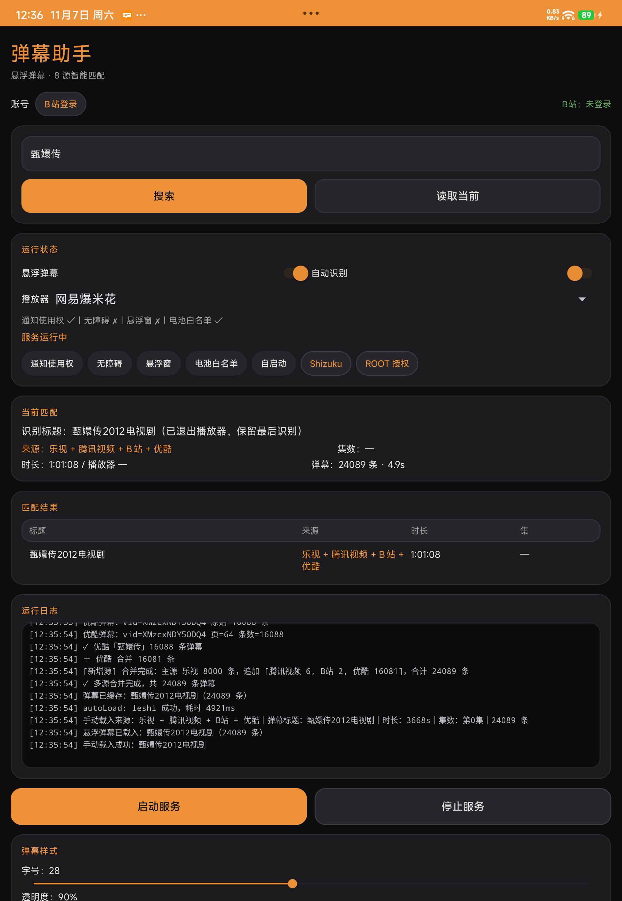

# 弹幕助手 · 多源弹幕聚合扩展

一个 Android 悬浮弹幕工具的数据源扩展实践：在原有多源检索的基础上接入**乐视、搜狐、AcFun** 三个新来源，并把「命中第一个源就停」改成「全部源并行搜索 + 合并去重」。单部剧集可用弹幕量从千级提升到万级。

> 个人技术学习与研究项目，不对外提供安装包下载，也不提供在线服务。



*同一部剧（甄嬛传2012电视剧）合并前 8000 条，合并后 24089 条，4.9 秒完成。*

## 做了什么事

原来的逻辑是逐源顺序检索，谁先命中就用谁，后面的源直接不查。问题有两个：

1. **先命中的不一定是最好的**。搜「甄嬛传」，乐视给 8000 条就停了，而优酷其实有 16081 条。
2. **新增的来源排在列表末尾，几乎永远轮不到**。前面六个源只要有一个命中，新源就不会被执行。

改造后：

- 九个源按顺序检索，第一个命中的作为**主源**，保证响应速度；
- 主源确定后，其余八个源并行检索，8 秒超时，各自返回结果；
- 所有结果按 `时间(0.1s 精度) + 模式 + 文本` 去重后合并，按时间轴排序；
- 界面显示主源与参与合并的源，例如「乐视 + 腾讯视频 + B站 + 优酷」。

实测数据：

| 关键词 | 单源结果 | 合并结果 | 耗时 | 主源 |
| --- | --- | --- | --- | --- |
| 甄嬛传2012电视剧 | 8,000 | 24,089 | 4.9s | 乐视 |
| 法医秦明 | 5,626 | 25,988 | 4.6s | 搜狐 |
| 葬送的芙莉莲 | 2,256 | 8,613 | 3.2s | 爱奇艺 |
| 狂飙 | 17,700 | 17,700 | 2.1s | 爱奇艺 |

## 数据源

| 来源 | 状态 | 说明 |
| --- | --- | --- |
| 乐视 | 新增 | so.le.com 搜索结果页 + hd-my.le.com 弹幕接口，300 秒分片 |
| 搜狐 | 新增 | 搜索需 md5 签名，弹幕接口按 vid + aid 拉取 |
| AcFun | 新增 | pc-direct 公开接口，resourceType 固定 9 |
| 爱奇艺 | 原有 | cmts.iqiyi.com |
| 腾讯视频 | 原有 | dm.video.qq.com |
| 优酷 | 原有 | acs.youku.com |
| B站 | 原有 | comment.bilibili.com（需登录 Cookie） |
| B站影视库 | 原有 | 番剧接口 |
| 弹弹play | 待接入 | 需要 OpenAPI 凭据，接口已实现，等待审核 |

## 技术实现

### 约束

原应用是 Kotlin 1.9 + 协程编译产物，没有源码工程，反编译回来的是不可重编译的形态。所以不能直接改 Gradle 工程重新构建。

### 扩展方式

采用「Java 扩展类 + 独立 dex + smali 桥接」：

- 新增来源的全部逻辑写在纯 Java 类里，编译时只依赖 `android.jar` 和少量签名桩，产出独立 dex 追加进 APK；
- 原应用的 `SourceManager` 里注入 5 处桥接：源列表构建、来源名称映射、单源加载分派、检索分派、合并入口；
- 桥接只做路由判断，不碰原应用的状态机与协程逻辑。

这样新来源的 HTTP 请求、JSON 解析、错误处理都在 Java 里写，能编译期检查签名，也便于单独测试。

### 合并策略

- 线程池固定 8 线程，每源超时 8 秒，单源失败不影响整体；
- 去重键为 `round(t * 10) + "|" + mode + "|" + text`，兼容不同来源的小数精度差异；
- 排序按时间戳升序，保证渲染顺序正确。

### 标题匹配收紧

新增来源最初的匹配过于宽松，搜「狂飙」会命中《少妇哭喊有人抢孩子……狂飙7分钟》，把 1000 条无关弹幕当成主源。收紧规则：

- 精确相等直接通过；
- 候选以关键词开头时，长度不得超过关键词的 4 倍 + 4；
- 候选包含关键词时，长度不得超过关键词 + 2；
- 关键词包含候选时，关键词长度不得超过候选的 3 倍 + 6；
- 去掉了「时长接近就算匹配」的兜底——宁可不命中，也不给无关弹幕。

另外 AcFun 增加了 `danmuCount >= 20` 的过滤，剔除几乎没有弹幕的结果。

## 弹弹play 接口调用说明

本项目只使用两个只读接口，不涉及 OAuth 授权，不读取用户账号数据。

**搜索动画**

```
GET https://api.dandanplay.net/api/v2/search/episodes?anime={关键词}
```

返回 `animes[].animeTitle` 与 `animes[].episodes[].episodeId`，用于建立「片名 → 剧集 ID」的对应关系。

**获取弹幕**

```
GET https://api.dandanplay.net/api/v2/comment/{episodeId}?withRelated=true
```

返回 `comments[]`，每项 `p` 字段为 `时间,模式,颜色,...` 的逗号分隔串，`m` 字段为弹幕文本。

**鉴权**

```
X-AppId:     {AppId}
X-Timestamp: {秒级时间戳}
X-Signature: Base64(SHA256(AppId + Timestamp + Path + AppSecret))
```

`Path` 为不含查询参数的接口路径，例如 `/api/v2/comment/12345`。

调用场景：用户播放动画时触发一次搜索，匹配成功后按集拉取一次弹幕，均为异步请求，无后台轮询、无批量爬取。日调用量为个位数，仅用于验证匹配准确度。

## 已知限制

- 弹弹play 需要凭据才能工作，未配置时该源静默跳过；
- B站接口需要登录 Cookie，未登录会触发 `v_voucher` 风控；
- 乐视、搜狐的 UGC 内容覆盖本来就少，冷门片名可能无结果；
- 合并会让单次检索变慢约 2–3 秒，换取的是弹幕量提升 2–4 倍；
- 咪咕、芒果TV 需要加密参数推导，巴哈姆特、PPTV 接口当前不可达，均未接入。

## 免责声明

- 本项目为个人技术学习与研究，不面向公众提供服务，无广告、无内购、无商业收入；
- 所有弹幕数据均来自各平台公开接口，获取后在设备本地实时渲染，不上传、不分发、不转售；
- 不存储用户身份信息，不采集设备标识；
- 项目不提供安装包分发，仅展示实现思路与验证结果。
